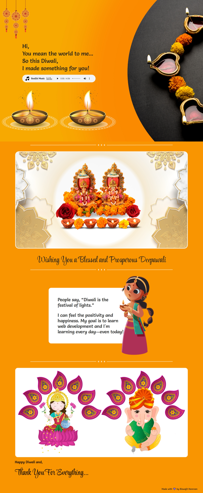

# 🪔 Diwali Wishes Website

A heartfelt and interactive Diwali wishes website built with HTML, CSS, and responsive design principles. This project showcases beautiful traditional imagery, soulful music, and warm messages to celebrate the festival of lights.



## 📑 Table of Contents

- [🌟 Features](#-features)
- [🚀 Live Demo](#-live-demo)
- [📱 Screenshots](#-screenshots)
- [🛠️ Technologies Used](#️-technologies-used)
- [📁 Project Structure](#-project-structure)
- [🎨 Design Features](#-design-features)
- [🔧 Setup Instructions](#-setup-instructions)
- [📱 Responsive Breakpoints](#-responsive-breakpoints)
- [♿ Accessibility Features](#-accessibility-features)
- [🎵 Audio Features](#-audio-features)
- [🔮 Future Enhancements](#-future-enhancements)
- [🐛 Known Issues](#-known-issues)
- [🤝 Contributing](#-contributing)
- [📄 License](#-license)
- [👨‍💻 Author](#-author)
- [🙏 Acknowledgments](#-acknowledgments)
- [📞 Contact](#-contact)

## 🌟 Features

- **Responsive Design**: Optimized for desktop, tablet, and mobile devices
- **Interactive Audio Player**: Background music with custom controls
- **Beautiful Imagery**: Traditional Diwali decorations and deity images
- **Smooth Animations**: CSS transitions and hover effects
- **Accessibility**: Focus styles and proper ARIA labels
- **SEO Optimized**: Meta tags and semantic HTML structure

## 🚀 Live Demo

[View Live Demo](https://biswajithemram.github.io/Diwali-wishes/) <!-- Add your live demo link -->

## 📱 Screenshots

<!-- Add screenshots of your website in different views -->
- Desktop View
- Tablet View  
- Mobile View

## 🛠️ Technologies Used

- **HTML5**: Semantic markup and accessibility features
- **CSS3**: Modern styling with Flexbox, Grid, and responsive design
- **Google Fonts**: Salsa and Style Script font families
- **Media Queries**: Mobile-first responsive design approach

## 📁 Project Structure

```
Diwali-Wishes/
├── index.html              # Main HTML file
├── style.css               # Main stylesheet
├── README.md              # Project documentation
├── assets/
│   ├── audio/
│   │   └── dhun.mp3       # Background music
│   └── image/
│       ├── deepak.png     # Diya lamp images
│       ├── diwali_toran.png
│       ├── favicon.png
│       ├── ganesh.png
│       ├── intro_background.png
│       ├── lakshmi_maa_and_ganesh_ji_1.png
│       ├── lakshmi.png
│       ├── little_girl.png
│       ├── music_icon.png
│       ├── soulful_music.png
│       ├── straight_line.png
│       └── three_dot_line.png
```

## 🎨 Design Features

### Color Palette
- Primary: `#f99501` (Orange/Saffron)
- Secondary: `#fff` (White)
- Text: `#1e1e1e` (Dark Gray)
- Background: `#f1f3f4` (Light Gray for audio player)

### Typography
- **Primary Font**: Salsa (cursive)
- **Secondary Font**: Style Script (cursive)
- **Responsive**: Uses `clamp()` for fluid typography

### Layout Sections
1. **Header/Intro**: Welcome message with toran decoration and audio player
2. **Blessing Section**: Main Diwali wishes with deity images
3. **Personal Message**: Developer's personal note about learning
4. **Gratitude Section**: Thank you message with Lakshmi and Ganesh images
5. **Footer**: Credits and attribution

## 🔧 Setup Instructions

1. **Clone the repository**:
   ```bash
   git clone git@github.com:BiswajitHemram/Diwali-wishes.git
   cd Diwali-Wishes
   ```

2. **Open in browser**:
   - Simply open `index.html` in any modern web browser
   - Or use a local server for better performance:
     ```bash
     # Using Python
     python -m http.server 8000
     
     # Using Node.js
     npx http-server
     ```

3. **View the website**:
   - Navigate to `http://localhost:8000` (if using local server)
   - Or open `index.html` directly in browser

## 📱 Responsive Breakpoints

- **Desktop**: 1440px and above
- **Tablet**: 768px - 1439px
- **Mobile**: 425px and below

## ♿ Accessibility Features

- Semantic HTML structure with proper headings
- Alt text for all images
- ARIA labels for interactive elements
- Keyboard navigation support with focus styles
- Screen reader friendly markup

## 🎵 Audio Features

- Background music with HTML5 audio controls
- Preload metadata for faster loading
- Fallback message for unsupported browsers
- Custom styling for audio player interface

## 🔮 Future Enhancements

- [ ] Add dark mode toggle
- [ ] Implement smooth scroll animations
- [ ] Add more interactive elements
- [ ] Create multilingual support
- [ ] Add loading animations
- [ ] Optimize images for better performance
- [ ] Add social sharing buttons

## 🐛 Known Issues

- Audio autoplay might be blocked by browser policies
- Some older browsers may not support CSS Grid features
- Large images may load slowly on slower connections

## 🤝 Contributing

1. Fork the repository
2. Create a feature branch (`git checkout -b feature/amazing-feature`)
3. Commit your changes (`git commit -m 'Add some amazing feature'`)
4. Push to the branch (`git push origin feature/amazing-feature`)
5. Open a Pull Request

## 📄 License

This project is open source and available under the [MIT License](LICENSE).

## 👨‍💻 Author

**Biswajit Hemram**
- Frontend Developer in Training
- Learning web development every day!

## 🙏 Acknowledgments

- Traditional Diwali imagery and cultural elements
- Google Fonts for typography
- Inspiration from Indian festivals and traditions
- Learning resources from Frontend BootCamp

## 📞 Contact

Feel free to reach out if you have any questions or suggestions!

---

**Made with 💜 by Biswajit Hemram**

*This project is part of my Frontend BootCamp learning journey. Happy Diwali! 🪔*
